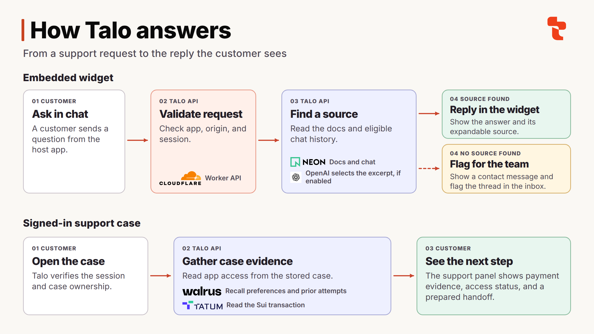

<p align="center">
  
</p>

<h1 align="center">Talo</h1>

<p align="center"><strong>Support that remembers what customers already tried.</strong></p>

<p align="center">
  <a href="https://talo.allensaji.dev">Visit Talo</a> |
  <a href="https://metricapp.allensaji.dev/app">Try the widget</a> |
  <a href="#architecture">Architecture</a> |
  <a href="#run-locally">Local setup</a>
</p>

Talo is an embedded support assistant for web apps. It answers from your
published support docs, picks up conversations for returning customers, and
gives your team the context to take over when a question needs human help.

| For customers | For support teams |
| --- | --- |
| Ask questions inside the app and see the source behind an answer. | Review and publish the knowledge the widget can use. |
| Resume a conversation with a verified identity and clear saved context from chat. | Read conversations, reply, and resolve requests for human help. |
| Check account details supplied by the host app, such as the current plan. | Track repeat contacts, feedback, and recurring topics in the insights dashboard. |

## Add Talo to an app

1. Open the Talo dashboard and register your website's exact origin.
2. Add customer-facing support docs, review them, and enable the widget.
3. Copy the embed snippet to your site and ask a question covered by your docs.

For customer-specific history or account details, have your backend authenticate
the customer and exchange its server key for a widget session scoped to that
customer, app, and origin. Pass the session to the widget with
`window.Talo.identify(token)`. See the
[widget guide](https://talo.allensaji.dev/docs/widget),
[server integration guide](https://talo.allensaji.dev/docs/server), and
[coding agent setup](https://talo.allensaji.dev/docs/agent).

## Architecture



| Layer | Technology | Responsibility |
| --- | --- | --- |
| Web app and API | React, TypeScript, vinext, Cloudflare Workers | Dashboard, embeddable widget, request validation, and server routes |
| Identity and storage | Neon Auth, Neon Postgres, Drizzle | Operator sessions, application settings, conversations, support cases, and memory job receipts |
| Scoped memory | Walrus Memory | Recall eligible customer preferences and prior troubleshooting attempts in signed-in support |
| Transaction evidence | Tatum Sui gRPC | Read a historical Mainnet transfer for server-side invoice matching |
| Optional generation | OpenAI Responses API | Select supporting excerpts for the widget and draft replies in the signed-in support flow |

### How a widget answer works

1. The API checks that the application is enabled and the request comes from a
   registered origin. Customer-specific history and account facts require a
   server-issued widget session.
2. Talo loads the published support docs and any eligible conversation history.
   It handles supported account questions separately, using facts supplied by
   the host backend.
3. For a docs question, Talo returns an answer with a source excerpt. If model
   generation fails or reaches its budget, Talo can return a matching excerpt
   directly.
4. The widget displays the reply and lets the customer expand its source when
   one is available. Talo saves the thread in Neon and flags unanswered
   questions for the team's inbox. The team can reply or resolve the thread.

### How signed-in support uses memory and evidence

A signed-in case can recall structured preferences and previously attempted
steps from Walrus. A scheduled Worker submits and polls memory jobs, and
Talo verifies the receipt, case scope, and record eligibility before reusing
a result. This lets a follow-up account for a failed step from an earlier visit.

For the payment and access case, Tatum returns a historical Sui Mainnet
transaction. The API compares it with a synthetic invoice and reads access
status separately from the app. The assistant can prepare a handoff with both
facts and the previous attempts. Payment inspection is read-only.

See the [architecture notes](docs/architecture.md) for request boundaries,
provider adapters, and the memory job lifecycle.

## Run locally

Use Node **24.22.1** and pnpm **10.8.1**. The local fixture mode starts with
synthetic cases and can run without provider credentials.

```sh
nvm use
pnpm install --frozen-lockfile
pnpm setup:local
pnpm cf:typegen
pnpm dev --host 127.0.0.1
```

Open [localhost:5173](http://127.0.0.1:5173) for the app or
[the support playground](http://127.0.0.1:5173/playground) for a seeded case.
`pnpm setup:local` creates an ignored `.dev.vars` file and preserves existing
settings. See [the configuration template](.dev.vars.example) for provider
settings.

```sh
pnpm check
```

The check runs TypeScript, unit tests, and the Worker build. For database
migrations, public sign-in, provider checks, and deployment, see the
[operations and integration guide](docs/operations.md).
